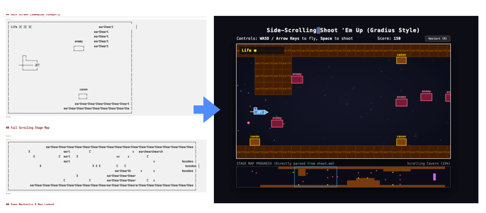

# `zago`: The Terminal Editor for 2D AI Prompts


- **Natural languages and traditional editors are limited** when you are working on a **multi-dimensional task**.
- **Object-based text diagram tools can generate diagrams**, but they cannot edit existing diagrams.
- **`zago` is a terminal editor featuring text diagrams for AI prompts**—for game design, UI layout, and more.



## Table of Contents

- [`zago`: The Terminal Editor for 2D AI Prompts](#zago-the-terminal-editor-for-2d-ai-prompts)
  - [Table of Contents](#table-of-contents)
  - [Why 2D AI Prompts?](#why-2d-ai-prompts)
  - [2D AI Prompt Showcase (`examples/ai_prompt`)](#2d-ai-prompt-showcase-examplesai_prompt)
    - [1. UI Layout Wireframe (`wireframe.md` → `wireframe.html`)](#1-ui-layout-wireframe-wireframemd--wireframehtml)
    - [2. Side-Scrolling Shoot 'Em Up (`shoot.md` → `shoot.html`)](#2-side-scrolling-shoot-em-up-shootmd--shoothtml)
  - [Key Highlights](#key-highlights)
  - [Quick Start \& Installation](#quick-start--installation)
    - [Requirements](#requirements)
    - [Install on macOS / Linux from Homebrew tap](#install-on-macos--linux-from-homebrew-tap)
    - [Install with Mint](#install-with-mint)
    - [Install on Linux (x86\_64 / arm64)](#install-on-linux-x86_64--arm64)
    - [Install on Arch Linux](#install-on-arch-linux)
    - [Install on Windows (PowerShell)](#install-on-windows-powershell)
  - [Build from Source](#build-from-source)
    - [macOS \& Linux](#macos--linux)
    - [Windows (Developers)](#windows-developers)
  - [Three Editing Modes in One Buffer](#three-editing-modes-in-one-buffer)
    - [1. 2D Canvas Mode (`F8` / `M+V`)](#1-2d-canvas-mode-f8--mv)
    - [2. Table Mode (`F7` / `M+T`)](#2-table-mode-f7--mt)
    - [3. Text Mode](#3-text-mode)
  - [Easy Drawing Commands (Editor LOGO)](#easy-drawing-commands-editor-logo)
  - [IPC Mode for Bidirectional AI Collaboration](#ipc-mode-for-bidirectional-ai-collaboration)
  - [CLI Usage \& Headless Unix Pipe Scripting](#cli-usage--headless-unix-pipe-scripting)
  - [Extra: TMD (Timebase Markdown) Music Score Support](#extra-tmd-timebase-markdown-music-score-support)
  - [Documentation](#documentation)
  - [Tests \& License](#tests--license)

## Why 2D AI Prompts?

When prompting AI coding assistants, **a 2D ASCII diagram is worth a thousand words of prose**.

Ever tried describing a multi-column UI wireframe or a game stage layout in plain English? You write paragraphs of relative positions (*"put the image box on the right, aligned with the first three paragraphs..."*), and the AI still gets it wrong.

Or ever tried editing an existing ASCII diagram in Vim or VS Code, only to watch every right-hand `│` border break alignment the moment you type a character? And once a diagram is saved as plain text inside a `.md` file, object-based drawing apps like ASCIIFlow can no longer edit those boxes as shapes.

With `zago`, you sketch and edit the 2D layout directly inside your Markdown file in the terminal:

```text
 ┌─────────────────────────────────────────────────────────────────────────────────────────────┐
 │  ZAGO                                                                                       │
 │  - The Terminal Editor for 2D AI prompts                                                    │
 ├─────────────────────────────────────────────────────────────────────────────────────────────┤
 │  Natural languages and traditional editors are limited   ┌────────────────────────────────┐ │
 │  when you are working on a multi-dimensional task        │                                │ │
 │                                                          │                                │ │
 │  Object-based text diagram tools can generate diagrams   │             image              │ │
 │  But they cannot edit existing diagrams                  │                                │ │
 │                                                          │                                │ │
 │  - Cross Platform         - Easy drawing commands        │                                │ │
 │  - Works in your terminal - CJK aware                    └────────────────────────────────┘ │
 ├─────────────────────────────────────────────────────────────────────────────────────────────┤
 │                                                         2026 (c) Weizhong Yang a.k.a zonble │
 └─────────────────────────────────────────────────────────────────────────────────────────────┘
```

Instead of switching between a code editor, an external ASCII drawing web app, a table generator, and an AI chat window, `zago` keeps everything in one plain-text buffer:

1. **Text Mode** treats the buffer as a linear stream for writing Markdown instructions and specs.
2. **2D Canvas Mode** (`F8` / `M+V`) treats the buffer as a freeform 2D coordinate plane where you can draw boxes, arrows, and rectangular blocks anywhere—and **edit existing plain-text diagrams in place**.
3. **Table Mode** (`F7` / `M+T`) treats tables as structured cells while keeping borders aligned across ASCII, CJK, and emoji characters.


## 2D AI Prompt Showcase (`examples/ai_prompt`)

The [`examples/ai_prompt/`](examples/ai_prompt) directory shows how plain-text 2D layouts drawn in `zago` act as unambiguous spatial specifications that AI agents can turn directly into working HTML5 applications:

### 1. UI Layout Wireframe ([`wireframe.md`](examples/ai_prompt/wireframe.md) → [`wireframe.html`](examples/ai_prompt/wireframe.html))

Draw the page header, two-column hero split, feature list, `image` placeholder box, and right-aligned footer in `zago`—and let the AI generate a responsive product landing page with an interactive terminal preview.

### 2. Side-Scrolling Shoot 'Em Up ([`shoot.md`](examples/ai_prompt/shoot.md) → [`shoot.html`](examples/ai_prompt/shoot.html))

Sketch both the **Main Screen HUD** (`Life ※ ※ ※`, `JET` ship silhouette, `enemy`, `canon`, `earth` walls) and the **Full Scrolling Stage Map** (`X` enemy waves, `C` cannons, cavern ceiling/floor terrain, and the `bossbos` arena at the end):

From that single 2D prompt, the AI builds a full-screen Gradius-style arcade shooter complete with terrain collision, a live stage-progress minimap, cosmic synth music, and a multi-phase Boss battle.

## Key Highlights

- **Cross Platform**: Runs natively on **macOS**, **Linux** (`x86_64` / `arm64`), and **Windows**.
- **Works in Your Terminal**: Zero Electron overhead; works over local shells, tmux, and remote SSH sessions with familiar Nano-compatible shortcuts (`^O` save, `^X` exit, `^W` search, `M+W` copy, `^K` cut, `^U` paste, `^Z` undo).
- **Edit Existing Diagrams In Place**: Open any Markdown or source file containing ASCII/Unicode boxes and modify, resize, move, or rewire them directly in 2D Canvas Mode.
- **Easy Drawing Commands**: Press `Esc` to invoke Editor LOGO commands like `BOX 30 5`, `BOX "Title" "center" "round"`, `LINE ARROW`, `TABLE 3 4 10 1`, `FILL "wall"`, or turtle graphics (`PD REPEAT 4 [ FD 8 RT 90 ]`).
- **CJK & Emoji Display-Width Aware**: Fullwidth East Asian characters and emojis (`✅`, `❌`, `⚠️`) are measured by true terminal display column width (`displayWidth = 2`), keeping boxes, tables, and rulers aligned.
- **Agent IPC & Ghost Text Preview**: AI agents can connect to `zago --ipc` or invoke the bundled `zago` skill (`zago --install-skill`) to push non-destructive Dim Gray 2D ghost text overlays (`Alt+A` to accept, `Alt+R` to reject).

## Quick Start & Installation

### Requirements

- **macOS 14.0+**, **Linux**, or **Windows**
- A VT100 / ANSI-compatible terminal with UTF-8 enabled (on Windows, use Windows Terminal)
- Swift 6.0+ *(only required if building from source)*

### Install on macOS / Linux from Homebrew tap

```bash
brew tap zonble/zago
brew tap --trust zonble/zago  # allow this third-party tap
brew install zago
zago notes.md
```

### Install with [Mint](https://github.com/yonaskolb/Mint)

```bash
mint install zonble/zago
zago notes.md
```

### Install on Linux (x86_64 / arm64)

```bash
curl -fsSL https://raw.githubusercontent.com/zonble/zago/main/install.sh | sh
zago notes.md
```

This downloads the pre-built static binary (`x86_64` or `aarch64`) to `~/.local/bin` without requiring a Swift toolchain. Set `INSTALL_DIR=/usr/local/bin` to customize the destination.

### Install on Arch Linux

```bash
git clone https://github.com/cawa0505/aur-zago.git zago-bin
cd zago-bin
makepkg -si
```

Maintained and automatically updated via GitHub Actions at [cawa0505/aur-zago](https://github.com/cawa0505/aur-zago).

### Install on Windows (PowerShell)

```powershell
irm https://raw.githubusercontent.com/zonble/zago/main/install.ps1 | iex
```

Downloads the pre-built `zago.exe` to `%LOCALAPPDATA%\Programs\zago` and configures your User `PATH` automatically.

## Build from Source

### macOS & Linux

```bash
git clone https://github.com/zonble/zago.git
cd zago
swift build -c release
.build/release/zago notes.md
```

On Linux, if Swift 6.0+ is not yet installed, install it via Homebrew (`brew install swift`), [swiftly](https://swiftlang.github.io/swiftly/), or [Swift.org](https://www.swift.org/download/). You can also install the built binary to `~/.local/bin` with `PREFIX="$HOME/.local" ./build.sh`.

### Windows (Developers)

1. Install the Swift toolchain via `winget install Swift.Toolchain`.
2. Open PowerShell as **Administrator** and build:

   ```powershell
   git clone https://github.com/zonble/zago.git
   cd zago
   swift build -c release
   .build\release\zago.exe notes.md
   ```

## Three Editing Modes in One Buffer

In all modes, ordinary typing remains **modeless**—just type to insert text.

### 1. 2D Canvas Mode (`F8` / `M+V`)

Unlocks 2D virtual space navigation beyond line ends so you can treat your document as a 2D grid:

- Move freely anywhere on the 2D plane without inserting trailing spaces until you draw or type.
- Draw 2D lines with `Shift+Arrows` and arrow-headed connector lines with `Ctrl+Arrows` (or `Ctrl+Shift+Arrows`).
- Rectangular 2D block selection (`^6` / `M+A`), block copy (`M+W`), block cut (`^K`), and block paste (`^U`) without shifting surrounding columns.

> [!TIP]
> On Windows Terminal or some Linux terminals, `Ctrl+Shift+Arrow` may be bound to terminal scrolling by default. You can either use `Ctrl+Arrow` in `zago` or unbind the conflicting shortcut in your terminal settings.

For details on 1D vs. 2D selection and clipboard behavior, see [Mark, selection, and canvas behavior](docs/user/mark.md).

### 2. Table Mode (`F7` / `M+T`)

Press `F7` or `M+T` inside any Markdown pipe table or Unicode box table:

- Navigate smoothly between cells while keeping table borders intact.
- Edit CJK, ASCII, and emoji content inside cells with automatic column-width alignment.

### 3. Text Mode

Standard linear text editing enhanced for technical and multilingual writers:

- **Markdown Outline & Link Navigation**: Jump across headings (`Alt+]` / `Alt+[` or `M+\`) and follow local document links (`M+O`) across Markdown, Org, reStructuredText, and AsciiDoc files.
- **CJK-Aware Justification (`^J`)**: Wraps and justifies mixed CJK/Latin paragraphs using visual display columns rather than byte counts.
- **Built-In Text Transformations**: Convert between Traditional and Simplified Chinese, normalize CJK/ASCII spacing, transliterate scripts (`Hiragana`, `Katakana`, `Latin`), and inspect character/word/CJK/emoji counts from the Tools menu.
- **Nano `.nanorc` Syntax Highlighting**: Load standard `.nanorc` syntax rules via `~/.zagorc`.

## Easy Drawing Commands (Editor LOGO)

Press `Esc` in the editor to open the command bar, or run commands from the CLI with `zago -e`. `zago` features a built-in **Editor LOGO** engine for generating and manipulating 2D shapes:

- **Boxes, Frames, & Fills**:

  ```logo
  BOX 30 5
  BOX "ZAGO" "center" "round"
  BOX 24 4 DOUBLE AT:DOWN
  GOTO 2 2 FILL "wall"
  ```

  Supported border styles: `LIGHT` (`┌─┐`), `ROUND` (`╭─╮`), `DOUBLE` (`╔═╗`), `HEAVY` (`┏━┓`), `ASCII` (`+-+`).
  Exit position modifiers (`AT:NE`, `AT:SE`, `AT:SW`, `AT:NW`, `AT:DOWN`) make chaining horizontal or vertical layouts effortless.

- **Tables & Connector Lines**:

  ```logo
  TABLE 3 4 10 1
  BOX "Client" "round" NE LINE ARROW 10 RIGHT BOX "Server" "double"
  ```

- **ASCII Architecture Diagram**:

  ```logo
  DRAWBOX 18 3 "client" CENTER GOTO 3 11 VLINE 3
  GOTO 5 1
  DRAWBOX 18 5
  GOTO 6 2 TYPE "     server     "
  ```

  Produces:

  ```text
  ┌────────────────┐
  │     client     │
  └─────────┬──────┘
            │
  ┌─────────┴──────┐
  │     server     │
  └────────────────┘
  ```

- **Turtle Graphics & Loops**:

  ```logo
  PD REPEAT 4 [ FD 8 RT 90 ]
  REPEAT 5 [ TYPE :# ". Item" NL ]
  ```

For the full language specification, see the [Editor LOGO Reference](docs/logo/reference.md).

## IPC Mode for Bidirectional AI Collaboration

Not only can you write 2D prompts *for* AI agents, AI agents can also draw and propose 2D edits *back into* your active `zago` session over IPC:

1. **Install the AI Skill**:

   ```bash
   zago --install-skill
   ```

2. **Start `zago` with IPC enabled**:

   ```bash
   zago --ipc architecture.md
   ```

3. **Review Ghost Text Proposals**:
   When an AI agent proposes a diagram or edit over the socket, `zago` renders it as a **Dim Gray 2D Ghost Text Overlay** at the target coordinates. Press `Alt+A` to accept and commit it into the buffer, or `Alt+R` to reject.

## CLI Usage & Headless Unix Pipe Scripting

`zago` works both as an interactive terminal editor (`export EDITOR=zago`) and as a headless CLI diagram generator / Unix pipe filter:

```bash
# Open a file at line 42, column 10 with an 80-column ruler
zago +42:10 prompt.md --wrap 80 --ruler

# Generate a 3-step flowchart in headless mode and print to stdout
zago -e 'BOX "Input" "round" AT:DOWN VLINE 2 BOX "Process" "double" AT:DOWN VLINE 2 BOX "Output" "round"'

# Pipe stdin text into zago and wrap it in a box
uptime | zago -e "box buffertext"

# Run a .logo script and copy the resulting 2D diagram to clipboard
zago -s architecture.logo | pbcopy
```

| Option | Description |
| :--- | :--- |
| `files` | File(s) to open, `-` for stdin pipe, or `+LINE[:COL]` cursor jump |
| `-w`, `--wrap <col>` | Set softwrap column width (e.g., `80`) |
| `-r`, `--ruler` | Display column ruler bar above the viewport |
| `-R`, `--readonly` | Open file(s) in read-only mode |
| `-e`, `--eval <code>` | Execute inline Editor LOGO code in headless mode and output to `stdout` |
| `-s`, `--run`, `--script <file>` | Execute a `.logo` script file in headless mode |
| `--ipc` / `--no-ipc` | Enable or disable the JSON-RPC 2.0 IPC socket server |
| `--install-skill` | Install the `zago` AI skill definition to local agent directories |
| `--init` | Generate a starter `~/.zagorc` configuration file |
| `--lang <en/zh_TW>` | Set interface language |

## Extra: TMD (Timebase Markdown) Music Score Support

Beyond 2D AI prompts and diagrams, `zago` includes built-in support for **TMD (Timebase Markdown)**—a plain-text music notation format for numbered musical notation (Jianpu), chord charts, and multi-track arrangements:

- Syntax highlighting for notes, octaves, durations, chords (`[Cmaj7]`), time signatures (`<4/4>`), and directives.
- Section outline jump (`M+\`) and ready-to-use score templates (`TMD -> Snippets`).
- One-click export to **MIDI** (`.mid`), **MusicXML** (`.xml`), **LilyPond** (`.ly`), **ABC** (`.abc`), and **WAV audio** (`.wav`).

## Documentation

- [Editor basics](docs/user/editor.md)
- [Mark, selection, and 2D canvas behavior](docs/user/mark.md)
- [Search behavior](docs/user/search.md)
- [Editor LOGO command language reference](docs/logo/reference.md)
- [Pen mode and turtle drawing](docs/logo/pen_mode.md)
- [Diagram snippets & menu rules](docs/features/diagram_snippets.md)
- [Configuration and key bindings](docs/user/configuration.md)
- [Spell checker architecture](docs/features/spell_checker.md)
- [File encoding & auto-detection](docs/features/encoding.md)
- [Homebrew tap](docs/development/homebrew_tap.md)
- [Release & preview builds](docs/development/release.md)
- [Changelog](CHANGELOG.md)

## Tests & License

Run `swift test` to execute the test suite.

MIT License. Copyright (c) 2026 Weizhong Yang a.k.a. zonble.

*Note: The name `zago` stands for "zonble's nano + LOGO".*
